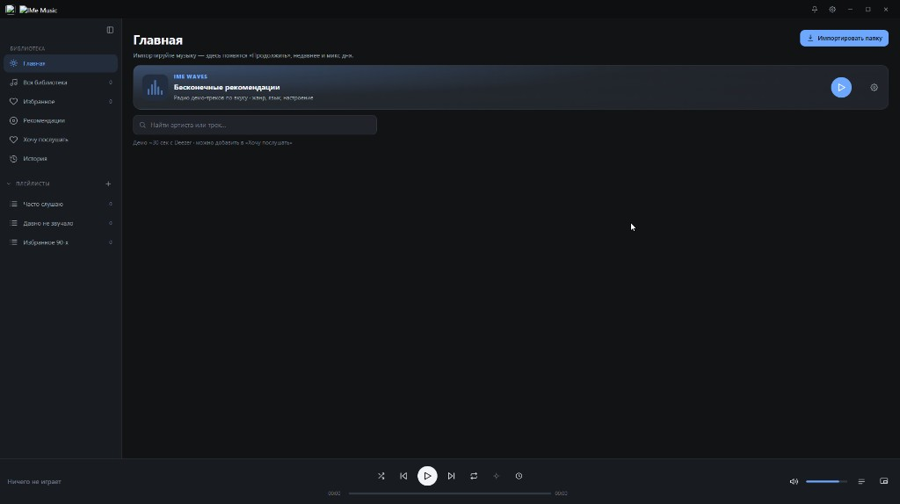
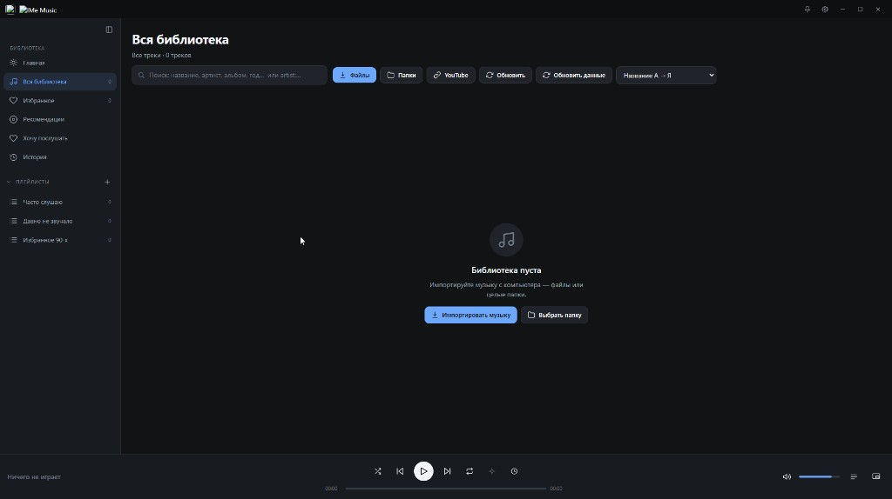
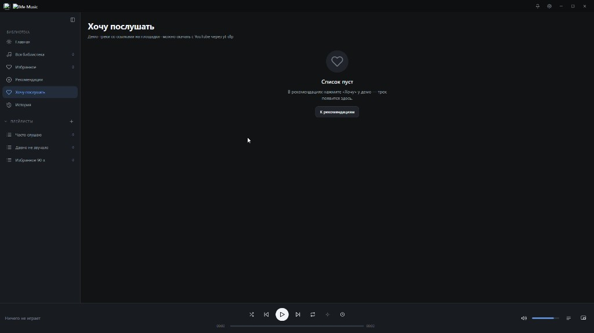
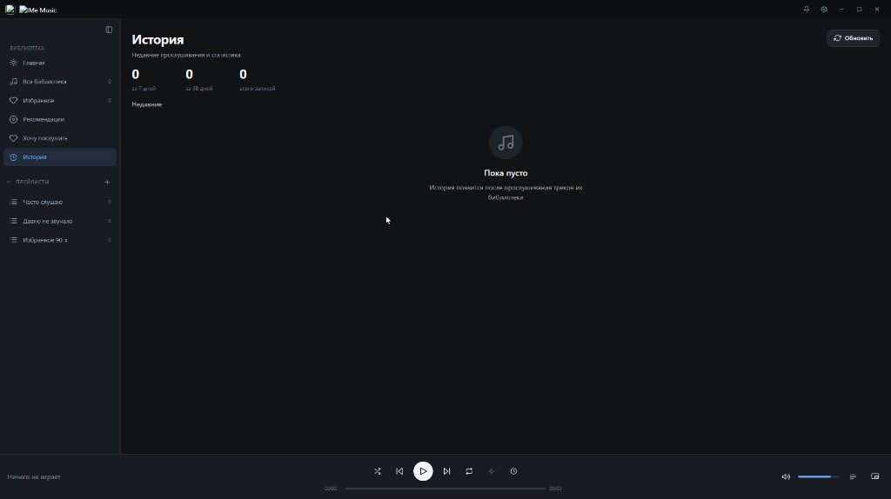
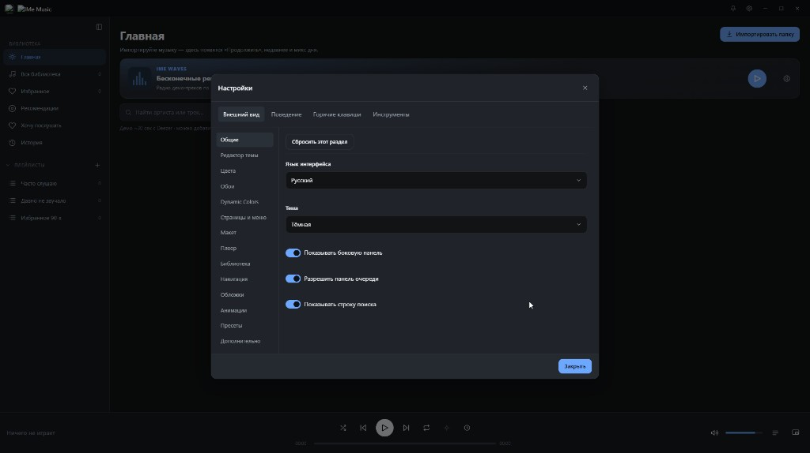
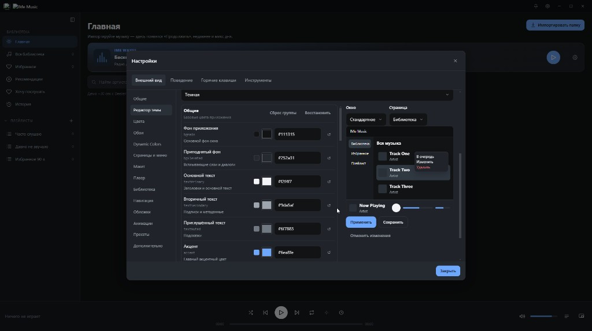
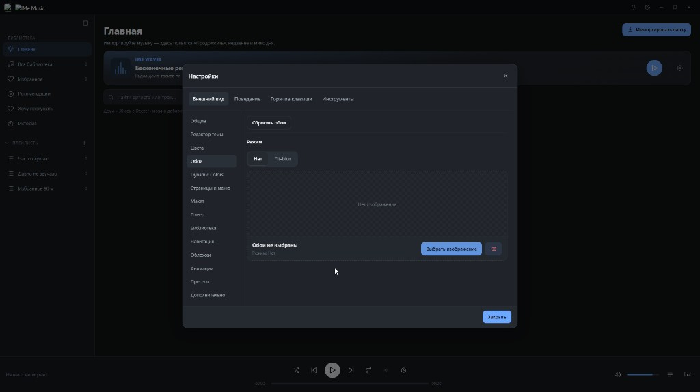
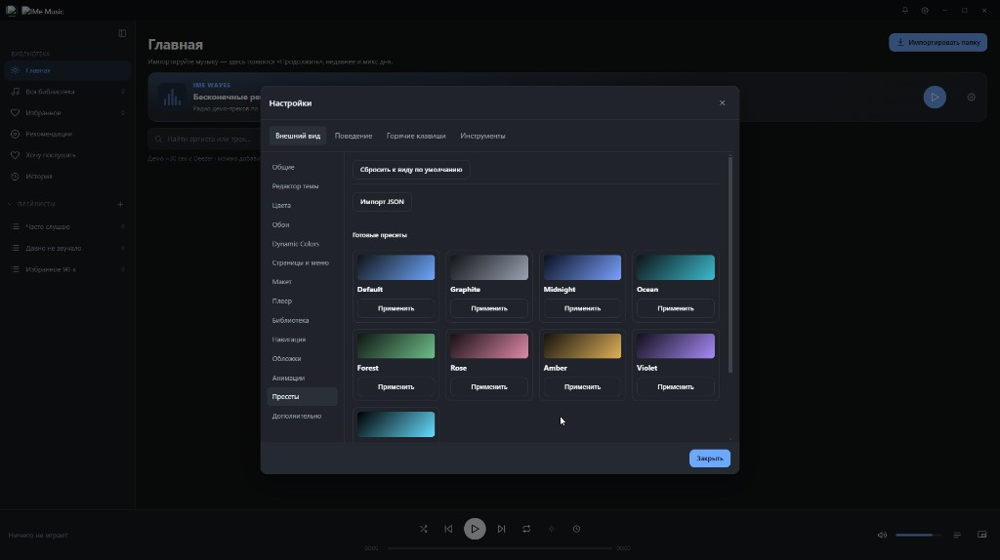
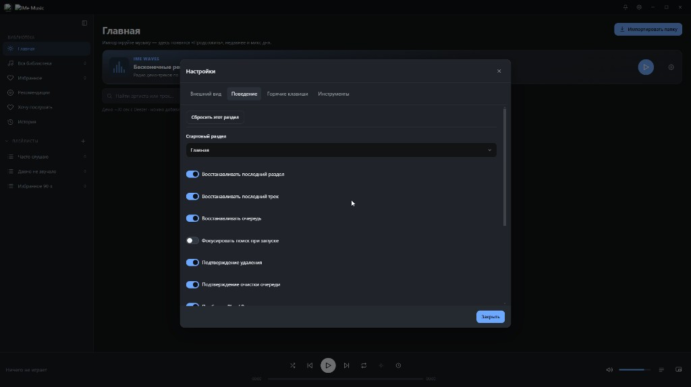
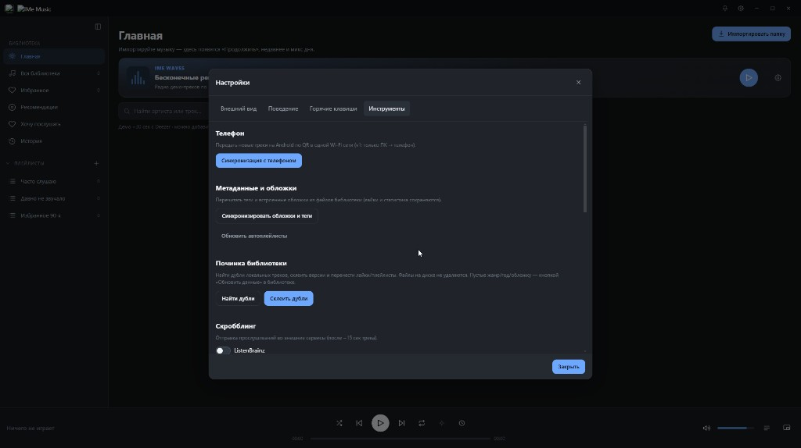

# IMe Music

Локальный музыкальный плеер для Windows (Electron): библиотека с диска, демо-рекомендации, **IMe Waves**, «Хочу послушать», синхронизация с телефоном и **полная система кастомизации интерфейса**.

<p align="center">
  
</p>

> В репозитории только **исходники приложения**. Личная библиотека, токены scrobbling и данные из `%APPDATA%` **не публикуются**.

## Скачать и установить (Windows)

Готовые сборки — во вкладке **[Releases](https://github.com/snepi/ime-music/releases)**.

### Способ 1 — установщик (рекомендуется)

1. Открой последний Release.
2. Скачай `IMe Music-Setup-*.exe`.
3. Запусти установщик, выбери папку, создай ярлыки.
4. Запускай **IMe Music** из меню Пуск / с рабочего стола.

Консоль и Node.js не нужны.

### Способ 2 — portable (без установки)

1. Скачай `IMe Music-Portable-*.exe`.
2. Запусти двойным кликом из любой папки (можно с флешки).

### Способ 3 — из исходников

Нужны [Node.js 20+](https://nodejs.org/) и npm.

```bash
git clone https://github.com/snepi/ime-music.git
cd ime-music
npm install
npm run rebuild:native
npm run dev
```

Сборка установщика:

```bash
npm run dist
```

Файлы появятся в `release/`.

---

## Скриншоты

| Главная · IMe Waves | Библиотека |
|:--:|:--:|
|  |  |

| Хочу послушать | История |
|:--:|:--:|
|  |  |

| Настройки · Общие | Редактор темы |
|:--:|:--:|
|  |  |

| Обои | Пресеты оформления |
|:--:|:--:|
|  |  |

| Поведение | Инструменты |
|:--:|:--:|
|  |  |

---

## Возможности

- Локальная библиотека (файлы / папки), поиск и сортировка
- Импорт с YouTube (через yt-dlp, опционально)
- Рекомендации и **IMe Waves** — бесконечное радио демо-треков с фильтрами жанра / языка / настроения
- «Хочу послушать», избранные артисты, карточки артистов и релизов
- Очередь, shuffle / repeat, sleep timer, мини-плеер, эквалайзер
- Синхронизация новых треков на Android (companion в `mobile/`)
- ListenBrainz / Last.fm scrobbling
- **Полная кастомизация внешнего вида** (см. ниже)

---

## Система кастомизации

Открой **шестерёнку** → вкладка **Внешний вид**. Это не «одна тема», а набор модулей, которыми можно собрать свой интерфейс с нуля или на базе пресетов.

### Разделы настроек

| Раздел | Что настраивается |
|--------|-------------------|
| **Общие** | Язык, светлая / тёмная тема, показ сайдбара, очереди, поиска |
| **Редактор темы** | Цвета по слоям: фон приложения, elevated-панели, основной / вторичный / muted текст, акцент; live-превью; Применить / Сохранить |
| **Цвета** | Точечная палитра UI-элементов |
| **Обои** | Фон окна (в т.ч. fill-blur), сброс обоев |
| **Dynamic Colors** | Динамический акцент (под обложку / палитру) |
| **Страницы и меню** | Оформление страниц и меню |
| **Макет** | Структура интерфейса |
| **Плеер** | Вид нижней панели: обложка, кнопки, плотность |
| **Библиотека** | Колонки списка, отображение треков |
| **Навигация** | Сайдбар и навигация |
| **Обложки** | Размер, скругление, fit обложек |
| **Анимации** | Переходы и motion |
| **Пресеты** | Готовые образы + импорт / экспорт JSON |
| **Дополнительно** | Тонкая донастройка |

### Пресеты «из коробки»

Default · Graphite · Midnight · Ocean · Forest · Rose · Amber · Violet — одним кликом **Применить**. Можно сбросить к виду по умолчанию или **импортировать JSON**-тему.

### Другие вкладки настроек

- **Поведение** — стартовый раздел, восстановление последнего экрана / трека / очереди, подтверждения удаления
- **Горячие клавиши** — свои шорткаты
- **Инструменты** — синк с телефоном по QR, перечитывание тегов и обложек, починка дублей библиотеки, scrobbling

Идея простая: **библиотека и плеер — функционал**, а **Внешний вид — отдельный конструктор**, чтобы приложение выглядело «твоим», а не шаблонным Electron-плеером.

---

## Структура репозитория

| Папка | Назначение |
|--------|------------|
| `src/` | UI (React) |
| `electron/` | Main-процесс Electron |
| `shared/` | Общие типы |
| `mobile/` | Companion для Android |
| `docs/screenshots/` | Скриншоты для README |
| `build/` | Иконки приложения |

---

## Лицензия

Исходники публикуются как есть для личного / community использования. Стриминг полных треков со сторонних сервисов не входит — только легальные демо (~30 сек) и ваши локальные файлы.
